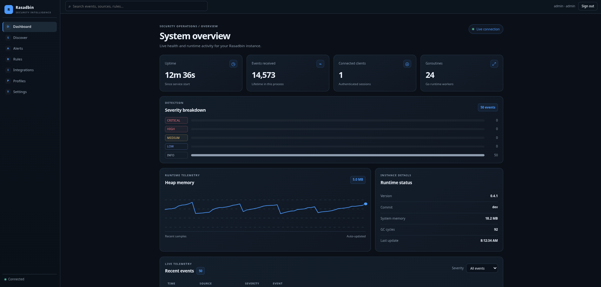
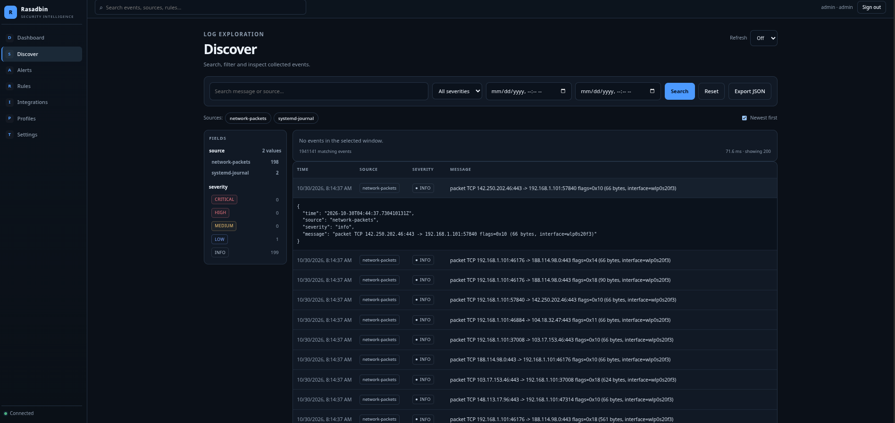
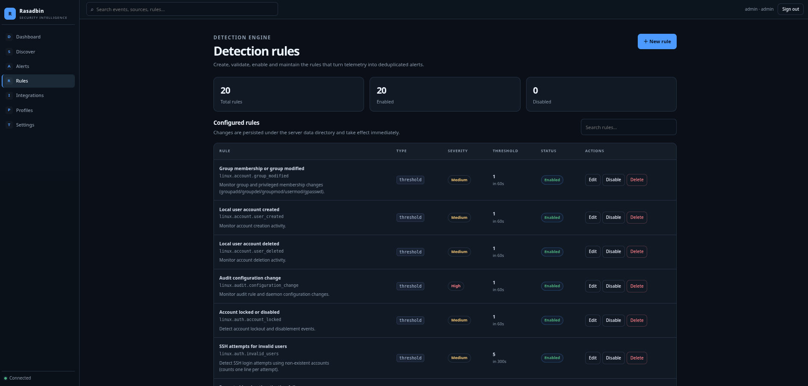
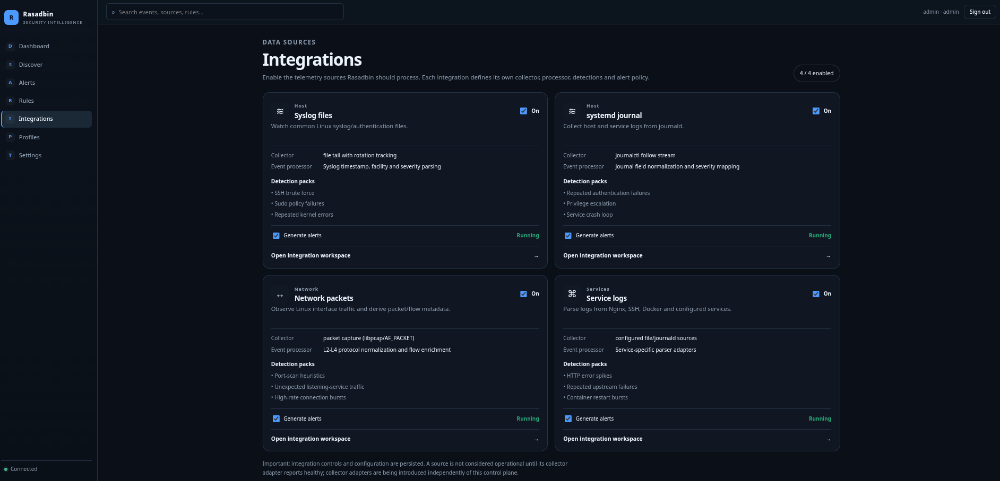
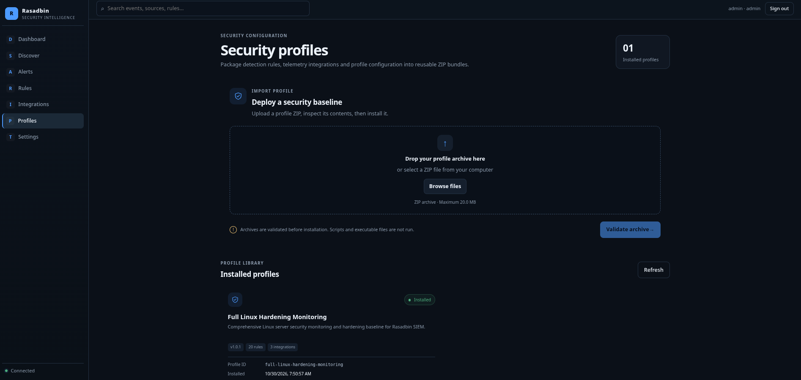

# Rasadbin SIEM Platform

**Rasadbin** is a Linux-first Security Information and Event Management (SIEM) platform written in Go. It collects, normalizes, analyzes, and correlates security events from network traffic, system logs, and service logs through a unified, self-hosted web interface.

The architecture is a modular monolith: collectors, detection, storage, and the web control plane are cleanly separated so each can evolve independently.

> **Project status:** Active development, pre-1.0. The web UI, authentication with persistent users/sessions, settings, integration control plane, security profiles, detection engine, discovery/search, alerts, and all four collectors are implemented. Storage supports SQLite, PostgreSQL, and MySQL via GORM. Treat it as suitable for controlled or lab deployments — not yet audited for security-critical production use.

---

## Screenshots

### Dashboard

Live health metrics, severity breakdown, heap telemetry, and the recent-event feed.



### Discover

Searchable event explorer with severity/source filters, a time histogram, and expandable event documents.



### Detection Rules

Create, validate, enable/disable, and delete detection rules from the UI.



### Integrations

Enable telemetry sources, toggle alerting, and open a per-integration workspace.



### Security Profiles

Import, validate, install, and remove reusable ZIP bundles of rules, integrations, and configuration.



## Features and Roadmap

### Data Collection

- [x] Live network packet capture on Linux network interfaces (AF_PACKET, metadata only).
- [x] TCP and UDP flow metadata extraction.
- [x] System log collection through `systemd-journald`.
- [x] File-based syslog collection with rotation and truncation handling.
- [x] Linux authentication and privilege-escalation event parsing (syslog heuristic severity).
- [x] Service-specific log parsers for Nginx, SSH, Docker, and other applications.
- [ ] Offline PCAP processing for testing and investigation.
- [ ] Configurable collection sources and filters.

### Event Processing

- [x] Common event schema for all collection sources (`web.Event`).
- [x] Event normalization and validation.
- [x] Bounded ingestion queues (hub recent buffer, store channel with drop counter).
- [ ] Host, process, user, and network context enrichment.
- [ ] Duplicate event detection.
- [ ] Persistent checkpoints for reliable log collection.
- [ ] Event correlation across multiple data sources.

### Detection and Alerting

- [x] Configurable detection rules using YAML or JSON (`data/rules/`).
- [x] SSH brute-force detection.
- [x] Network port-scan detection.
- [x] Repeated authentication-failure detection.
- [x] Rule-based alert generation, deduplication, and severity.
- [x] Persistent alert records (SQLite/PostgreSQL/MySQL via GORM).
- [x] Alert triage workflow: new, acknowledged, investigating, resolved, false positive.
- [x] Analyst assignment, notes, and append-only activity history.
- [x] Alert search/filtering and live WebSocket updates.
- [ ] Service failure monitoring.
- [ ] Time-window-based event aggregation.
- [ ] Threshold-based detection.
- [ ] Incident and case management.
- [ ] Future support for a compatible subset of Sigma rules.

### Web Interface

- [x] Dashboard with live stats, severity breakdown, heap chart, and event feed.
- [x] Discover log explorer (query, severity/source/time filters, histogram, JSON export, live append).
- [x] Persistent Alerts workspace with filters, evidence, status workflow, assignment, notes, and activity history.
- [x] Detection rules editor (admin).
- [x] Integration control plane + per-integration workspace (admin).
- [x] Security profile import/export (admin).
- [x] Settings page (admin).
- [x] WebSocket-only API (single `/ws` endpoint).

### Operations

- [x] Persistent users and sessions (hashed, PBKDF2-SHA256) in the database.
- [x] Persistent event storage (SQLite/PostgreSQL/MySQL via GORM).
- [x] Health endpoint (`/healthz`).
- [x] Graceful shutdown with store drain.
- [x] Configurable runtime settings (persisted to `DATA_DIR/settings.json`).
- [ ] Metrics endpoint.
- [ ] Enforced event retention (setting persisted, enforcement pending).
- [ ] systemd unit / packaging.

## Architecture

Rasadbin follows a modular monolithic architecture. Collection, processing, detection, storage, and API components are designed to remain independent so they can evolve without requiring a complete rewrite.

```text
+------------------------------------------------------+
|                    Web Interface                     |
|    Dashboard | Integrations | Settings | Events      |
+----------------------------+-------------------------+
                             |
+----------------------------v-------------------------+
|                WebSocket Hub / Auth                  |
|     Sessions | Integrations | Settings | Events      |
+----------------------------+-------------------------+
                             |
+----------------------------v-------------------------+
|                   Event Processing                   |
| Normalize | Enrich | Deduplicate | Correlate         |
+----------------------------+-------------------------+
                             |
+----------------------------v-------------------------+
|                    Detection Engine                  |
|         Rules | Thresholds | Time Windows            |
+----------------------------+-------------------------+
                             |
+----------------------------v-------------------------+
|                     Storage Layer                    |
|       Events | Alerts | Rules | Checkpoints           |
+------------------------------------------------------+

                       Data Sources

+------------------+ +----------------+ +---------------+
| Network Capture  | | System Logs    | | Service Logs  |
| AF_PACKET / TCP  | | journald/Audit | | Files / Syslog|
+------------------+ +----------------+ +---------------+
```

## Requirements

### Development Environment

- Linux development environment.
- Go toolchain compatible with the version declared in `go.mod` (Go 1.27.2).
- Git.
- Node.js and npm for frontend development.
- Root privileges or `CAP_NET_RAW` for live packet capture.

On Debian or Ubuntu:

```bash
sudo apt update

sudo apt install -y \
  git \
  build-essential \
  pkg-config
```

Install Go and Node.js separately if they are not already available. Note: libpcap is not required by the current code, which uses raw AF_PACKET sockets directly.

## Getting Started

### 1. Clone the Repository

```bash
git clone <REPOSITORY_URL> rasadbin
cd rasadbin
```

Replace `<REPOSITORY_URL>` with the actual repository URL.

### 2. Install Go Dependencies

The module is declared as `rasadbin` in `go.mod`. The only external dependency is the WebSocket library:

```bash
go mod tidy
```

### 3. Build the Web UI

The Go server serves static assets from `webui/dist`. Build them first:

```bash
cd webui
npm install
npm run build
cd ..
```

### 4. Run the Application

The main package lives at `cmd/app`. From the repository root:

```bash
go run ./cmd/app help
go run ./cmd/app version
go run ./cmd/app run
```

The CLI reports the product name `Rasadbin`, the command name `rasadbin`, the version constant from `cmd/app/version.go`, and the Git commit hash injected at build time (or `dev` when built without `scripts/build.sh`).

By default, the HTTP server listens on:

```text
127.0.0.1:8080
```

A convenience script is available:

```bash
./scripts/run_server.sh
```

This runs the server on `127.0.0.1:9090`.

On first run, if `ADMIN_PASSWORD` is not set, a random admin password is generated and printed to stderr. Set it via `.env` or the environment to choose your own (minimum 10 characters).

### 5. Verify the Health Endpoint

In another terminal:

```bash
curl -i http://127.0.0.1:8080/healthz
```

The implementation returns an HTTP 200 response similar to:

```json
{
  "status": "ok",
  "service": "rasadbin",
  "version": "0.4.1"
}
```

### 6. Build the Binary

The build script injects the current short Git commit hash into the binary via `-ldflags -X main.commit=...`. The application version is a compile-time constant in `cmd/app/version.go` and is not overridden by the build.

```bash
./scripts/build.sh
```

## Development Commands

Run the following commands from the repository root.

```bash
# Format Go source files
gofmt -w .

# Run all Go tests
go test ./...

# Run the race detector
go test -race ./...

# Run static analysis
go vet ./...

# Build the application (with commit hash injected)
./scripts/build.sh

# Type-check and build the frontend
cd webui && npm run typecheck && npm run build
```

Use `golangci-lint` when configured for the repository.

## Configuration

Rasadbin resolves configuration with the following precedence (highest wins):

1. Explicit CLI flags
2. Real environment variables
3. Values from the `.env` file (loaded into the environment)
4. Built-in defaults

### Bootstrap Configuration

Loaded at startup from `.env`, the environment, and CLI flags. See `.env.example`.

| Variable            | Flag                  | Default             | Description                                   |
| ------------------- | --------------------- | ------------------- | --------------------------------------------- |
| `HTTP_HOST`         |                       | `127.0.0.1`         | HTTP bind host                                |
| `HTTP_PORT`         |                       | `8080`              | HTTP bind port                                |
| `DATA_DIR`          | `--data-dir`          | `./data`            | Directory for persisted settings              |
| `WEBUI_DIR`         | `--webui-dir`         | `webui/dist`        | Path to built web UI assets                   |
| `ADMIN_PASSWORD`    |                       | (generated)         | Initial admin password (min. 10 characters)   |
| `CAPTURE_INTERFACE` | `--capture-interface` | (collector default) | Linux interface for packet capture            |
| `MAX_GOROUTINES`    | `--max-goroutines`    | (NumCPU)            | Maximum OS threads/goroutines for the runtime |
| `ENV_FILE`          |                       | `.env`              | Path to the environment file                  |

The `--listen` flag overrides `HTTP_HOST`/`HTTP_PORT` directly.

## Security Profiles

A security profile is a ZIP archive that packages detection rules, integration settings, and (optionally) configuration files into a reusable, versioned baseline.

```text
manifest.yaml
rules/*.yaml|*.json
integrations/*.yaml|*.json
config/*.yaml|*.json
README.md          (optional)
```

## Security Considerations

Rasadbin is intended to handle sensitive system and network telemetry. Security must be considered throughout development.

- Bind the management interface to localhost by default.
- Do not expose the API publicly without appropriate authentication, authorization, and TLS.
- Avoid running the entire application as root.
- Grant packet-capture and log-reading permissions only where required (`CAP_NET_RAW` for network capture).
- Validate and sanitize untrusted event data.
- Protect management endpoints against unauthorized changes.
- Record sensitive administrative operations in an audit log (login, settings changes, integration toggles, password changes are logged).
- Apply retention limits and protect stored event data.
- Avoid collecting or retaining packet payloads unless explicitly required (the network collector emits L3/L4 metadata only).
- Do not treat a successful health check as proof that the entire SIEM is functioning correctly.

Packet visibility depends on the network interface and deployment topology. Capturing on an ordinary interface does not automatically expose traffic between other hosts. A network TAP, mirrored switch port, or suitable observation point may be required.

## Design Principles

1. **Modularity:** Collectors, processing, detection, storage, and API components should have clear boundaries.
2. **Linux-first:** Prioritize Linux collection mechanisms and deployment in the initial release.
3. **Extensibility:** New data sources and detection rules should not require rewriting the event-processing pipeline.
4. **Resource control:** Use bounded queues, explicit timeouts, and backpressure handling.
5. **Reliability:** Track collection checkpoints and handle restarts, log rotation, and partial failures.
6. **Observability:** Monitor collector health, processing latency, dropped events, and storage failures.
7. **Security by default:** Apply least privilege, validate inputs, and keep the management interface protected.
8. **Testability:** Support synthetic events and offline PCAP replay for reproducible tests.

## Contributing

Contributions are welcome as the project develops.

When submitting changes:

- Follow standard Go formatting conventions.
- Keep packages focused on a single responsibility.
- Add unit tests for new functionality.
- Include integration tests for collectors and storage changes where practical.
- Document new configuration options and detection rules.
- Avoid introducing unnecessary dependencies.
- Report security vulnerabilities privately rather than publishing exploit details in public issues.

Contribution guidelines and the security reporting process will be documented separately as the project matures.

## License

The project license has not yet been specified.

Add a `LICENSE` file before publishing a release or distributing the software. Do not assume that the project is open source under a particular license until one has been selected.

## Disclaimer

Rasadbin is an early-stage security monitoring project. It is not yet a replacement for a mature production SIEM, endpoint detection platform, or network intrusion detection system.

Use it initially in a controlled development or test environment. Validate detection coverage, event loss, access controls, and recovery behavior before relying on it for security-critical monitoring.
